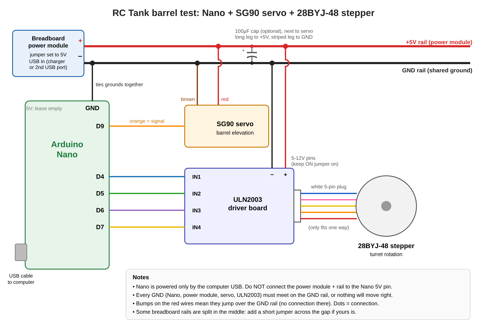

# Phase 1: Proof of concept (barrel + turret demo)

**Status:** ✅ Done

## What
A breadboard demo on an Arduino Nano:

- **SG90 servo = barrel elevation** (up/down)
- **28BYJ-48 stepper + ULN2003 = turret rotation** (left/right)

Both are controlled with typed commands in the Serial Monitor, and both can move at the same time.

> **Credit:** The sketches and schematic in this phase were written by Claude (AI assistant) with me. I wired the circuit, uploaded the code and tested it on the breadboard.

## Why
Phase 0 showed both motors work, but the code blocked, so they couldn't move smoothly together. The real tank needs the turret and barrel moving at once without one freezing the other. This phase also moved to a proper shared 5V rail with a common ground.

## Goal
Both motors moving together using non-blocking code, with only the built-in libraries.

## Parts used in this phase
- Arduino Nano, prototyping brain (the final tank uses an ESP32)
- SG90 servo `(already have in kit)`
- 28BYJ-48 stepper + ULN2003 driver board `(already have in kit)`
- Breadboard power module, set to 5V, USB powered `(already have in kit)`, prototyping only
- Breadboard and jumper wires `(already have in kit)`, prototyping only
- 100µF capacitor, optional `(already have in kit)`

## Wiring

([SVG version](schematic.svg))

| From | To | Wire |
|---|---|---|
| Nano D9 | Servo signal | orange |
| Servo + | +5V rail | red |
| Servo − | GND rail | brown |
| Nano D4 | ULN2003 IN1 | |
| Nano D5 | ULN2003 IN2 | |
| Nano D6 | ULN2003 IN3 | |
| Nano D7 | ULN2003 IN4 | |
| ULN2003 + (5-12V) | +5V rail | |
| ULN2003 − | GND rail | |
| 28BYJ-48 plug | ULN2003 white socket | keyed, fits one way |
| Nano GND | GND rail | **required**, shares ground |
| Power module (5V jumper) | both breadboard rails | USB powered |
| 100µF cap (optional) | + leg to +5V, striped leg to GND, near servo | |
| Nano 5V pin | **nothing** | Nano runs from computer USB |

## Sketches

| Sketch | What it does |
|---|---|
| [servo_only_test](servo_only_test/servo_only_test.ino) | Swings the servo 0° → 90° → 180° on its own. Checks the servo wiring. |
| [stepper_only_test](stepper_only_test/stepper_only_test.ino) | Lights the ULN2003 LEDs one at a time, then turns one full turn each way. No library. Checks the stepper wiring. |
| [barrel_test](barrel_test/barrel_test.ino) | **The demo.** Barrel and turret controlled by Serial commands, both moving at once. |

### How the demo works
The loop never waits. Every pass it checks for a typed command, then moves the servo one degree toward its target if enough time has passed, and moves the stepper one step toward its target if enough time has passed. Because nothing blocks, both motors move together.

### Upload (Arduino IDE)
1. Tools > Board > Arduino AVR Boards > **Arduino Nano**.
2. Tools > Processor > **ATmega328P**. If upload fails with "not in sync", pick **ATmega328P (Old Bootloader)**.
3. Pick the port and upload. No libraries to install.
4. Open Serial Monitor at **9600 baud**, line ending **Newline**.

### Serial commands

| Type | Does |
|---|---|
| `e120` | barrel to 120° |
| `u` / `d` | barrel up / down 5° |
| `t90`, `t-45` | turn turret by degrees |
| `s512` | turn turret by raw steps (2048 = one turn) |
| `h` | turret back to zero |
| `z` | set current turret spot as zero |
| `x` | stop turret |
| `demo` | move both at the same time |
| `?` | help + status |

## What I learned
- The first upload looked like it did nothing. The sketch just sits and waits for a command, so nothing moves until you type one. Typing `demo` made both motors move together.
- Non-blocking code (checking `millis()` / `micros()` instead of using `delay()`) is what lets two motors move at once.
- Every ground has to meet on the same GND rail, or the servo twitches and things act randomly.
- The Nano runs from the computer's USB, and the motors run from the power module's 5V rail. The two only share ground.

## Notes from the bench
- **Test mount:** to hold the servo and stepper together like the finished turret would be, I mounted the servo on top of the stepper motor using a silicone bottle opener I got from the Equitable career fair.
- **Broken DC motor:** earlier the same day I was working with a DC motor and snapped its connected cables. I soldered them back on, but I think I did something wrong, because the motor stopped working afterwards. Something to check before I use it again.

## Blog days
- [Day 1 - Proof of concept](https://github.com/HiMyNamesSeb/Blogs/blob/main/rc-tank-project/d1-proof-of-concept.md)
